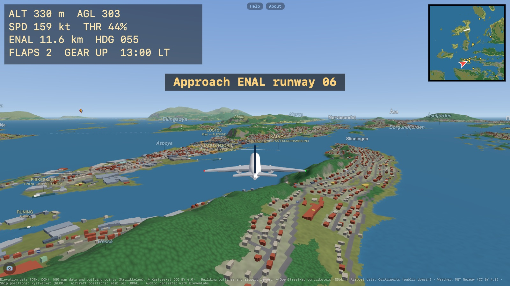

# teinum-fly

[](https://fly.teinum.no/?apt=ENAL)

Flysimulator over ekte norsk terreng: innflyging med Airbus A320 til Kjevik (ENCN),
Sola (ENZV), Flesland (ENBR), Ålesund (ENAL), Gardermoen (ENGM), Bodø (ENBO), Tromsø (ENTC), Mehamn (ENMH) eller Kjeller (ENKJ), med en tur over Oslo sentrum (`?apt=ENKJ&tour`, eller `T` forbi siste bane). Hver flyplass har et kartutsnitt
på 25,6 x 25,6 km i 10 m-celler (Kjeller: 30,7 km, så Oslo sentrum er med). WebGL, sann målestokk, bygninger
og bruer som geometri, sol og mørke etter klokka, og cockpit med instrumentpanel.

## Kjøre

Forutsetninger: [uv](https://docs.astral.sh/uv/) og Node 22.

```bash
# 1. Pipeline: hent data og skriv fliser (laster ned ca. 280 MB første gang, deretter fra cache)
cd pipeline
uv run flypipe build all        # alle flyplasser (42 MB hver, ikke i git; ca. 1,3 GB nedlasting første gang)
uv run flypipe build kjevik10   # eller bare én: kjevik10, sola10, flesland10, gardermoen10, bodo10
uv run pytest

# 2. Spill
cd ../web
npm install
npm run dev          # http://localhost:5173
npm test
```

Spillet tilbyr de flyplassene som er bygget. 50 m-flisene i `web/public/data/kjevik/`
er sjekket inn fordi testene bruker dem; spillet gjør det ikke lenger.
`data/raw/` (cache) kan slettes for å hente alt
på nytt. `data/processed/kjevik/*.tif` er georefererte kopier som kan åpnes
i QGIS for kontroll mot andre kartlag.

Du starter 8 km ute med klaff 2 og understellet oppe. Ta ut understellet og
full klaff, brems til ca. 140 kt, og land. Landing med understellet oppe er
buklanding.

Spillet fyller hele nettleservinduet. «Hjelp» øverst viser tastene og har en knapp
for fullskjerm.

Taster: piltaster styrer, `W`/`S` gass, `G` understell, `F`/`V` klaff ut/inn,
`C` bytter mellom utvendig kamera, cockpit og tårn, `R` ny innflyging, `T` bytt bane (03/21), `Q`/`E` stiller klokka en
halvtime bakover/framover, `Y` åpner datovelgeren (samme klokkeslett på en annen dato, f.eks. midtsommer), `M` slår lyden av og på, `N` stedsnavnene, `D` flight director, `P` fartsvektoren,
`1`/`2`/`3` autobrems LO/MED/MAX, `Z` rekkevidden på ND (10, 20, 40 NM), `X` terrenget på ND av og på. Lyden starter ved første tastetrykk.

`U` ser opp på overheadpanelet og `J` ned på midtkonsollen (samme tast en gang til ser fram igjen). Der virker
setebeltebryteren og TERR på GPWS-panelet (oppe), og gasshåndtakene, luftbremsen med armering av bakkespoilerne,
klaffspaken, ECAM-tastene ENG og WHEEL og TCAS-velgeren (nede). Resten er tegnet for at panelene skal ligne.

`L` slår morofigurene av og på (sjimpansen over Dyreparken, krona over Slottet, nordlys i nord og flere; se `web/src/figures.ts`). `?fun=0` starter uten dem. `H` (eller skipsknappen nede til venstre) åpner en liste over de ekte skipene i utsnittet (AIS); velg ett, og flyet svinger mot det og følger det. Framme tas det et bilde av skipet med lang brennvidde, så skipet er motivet.

Kameraknappen nede til venstre (eller `K`) tar et bilde til deling: utsikten med en stripe nederst som sier hvor flyet er, høyde, fart, flyplass og tid. Bildet kopieres til utklippstavla med en gang, og en liten meny viser det og lar deg også laste det ned (og dele det, der enheten har delingsark).

I tårnet zoomer `+` og `-`, musehjulet eller et trykk på kikkerten på benken inn på flyet (2x, 4x, 8x).

I cockpit kan understellsspaken, luftbremsen, gasshåndtakene (dra), klaffspaken og knappene AP1 og FD også
betjenes med mus eller finger.

Flyplass velges under «Hjelp» eller med `?apt=ENZV` (ICAO-kode). `T` blar gjennom alle
baneender på flyplassen.

URL-parametre: `?apt=ENGM`, `?wind=240/15` (vind fra 240° sann retning, 15 kt; uten den brukes flyplassens vind akkurat nå), `?cam=cockpit` eller `?cam=tower`, `?rwy=21`, `?taxi` (start på rullebanen etter landing, for å øve på taksing), `?cfg=full` (start med understell nede
og full klaff), `?time=22:00` og `?date=2026-06-21`
(norsk tid; uten dem starter spillet kl. 13:00 i dag), og `?pos=øst,nord,høyde,kurs` (UTM 33,
meter, sann kurs), f.eks. `?pos=91725,6468775,70,174` for Varoddbrua.

## Innflyging

PFD viser en magenta rombe for glidebanen (til høyre for horisonten) og en for kursen
(under den), slik et ILS-anlegg gjør: fly mot romben. Står begge i midten, er du på
senterlinja og på 3° glidebane. ND viser forlenget senterlinje med et merke per nautiske
mil. Veiledningen er regnet fra banegeometrien, ikke fra flyplassens faktiske anlegg.

## Terrengvarsel

I cockpit varsler flyet når det er på vei i terrenget: «terrain ahead» og gul tekst på ND når det er under
45 sekunder til, «pull up» og rødt når det haster. Terrenget det gjelder er helfarget på ND. Varselet regnes fra
høydekartet og flyets bane akkurat nå (`web/src/gpws.ts`); reglene er forenklet og gjelder ikke bygninger og bruer.

## Flyplassen på bakken

Taksebaner, oppstillingsflater og stands er fra OpenStreetMap og tegnes som asfalt med gule senterlinjer og
standnumre. Skiltene følger det vanlige mønsteret: svart med gul bokstav er taksebanen du står på, gult med svart
bokstav og pil er taksebanene som tar av (også langs rullebanen, foran hver avkjøring), og rødt med hvit tekst er
rullebanen foran et ventepunkt, der det også er malt to hele og to stiplede linjer tvers over taksebanen. Hvor
skiltene står er satt etter regel, ikke kartlagt. Dataene ligger i `data/osm/<utsnitt>.aeroway.json` og hentes for hånd med `uv run flypipe aeroways <utsnitt>`.

## Vind

Det blåser i spillet som på flyplassen akkurat nå: vinden er fra flyplassens siste METAR (Meteorologisk institutt),
hentet via en liten tjeneste på samme nettsted (`web/public/weather/`). Den er jevn over hele kartet; kastene leses
opp av tårnet, men flymodellen bruker bare middelvinden. Spillet velger banen med mest motvind, og tårnet leser opp
vinden i klareringen. Svarer ikke tjenesten, er det vindstille. `?wind=240/15` setter vinden selv (fra 240° sann
retning, 15 knop), og `?wind=0/0` gir vindstille.

Flyet flytter seg med lufta: nesa må peke opp mot vinden for å holde senterlinja, motvind gir lavere fart over bakken og kortere
utrulling. ND viser vinden med pil, og fart over bakken (GS) ved siden av farten gjennom lufta (TAS). Den grønne
romben på kursbåndet på PFD og på kompassbuen på ND viser kursen over bakken. `P` viser fartsvektoren
(«fuglen») på PFD: et grønt symbol som står der flyet faktisk er på vei, ut til siden når det driver. Autopiloten og flight director
regner med vinden.

## Etter landing

Når hjulene tar bakken går bakkespoilerne ut av seg selv, og autobremsen bremser flyet: LO 1,7 m/s², MED 3 m/s²
(ca. 700 m fra 126 kt) eller MAX 8 m/s². Hver innflyging starter med MED, eller MAX der banen er for kort for
MED (Mehamn) eller der MED ville rullet forbi banens siste avkjøring (Kjevik bane 03). Mellomrom bremser hardt
for hånd under utrullingen. Ruller flyet av enden på banen i fart, er det en utforkjøring. MAX er sterkere enn flyet klarer;
uten det kunne ingen landet på Mehamns 880 m.

## Taksing

Når flyet har rullet ned til ca. 30 knop kan du ta over og takse: `W` gir gass (og starter taksingen), `S` tar den av,
piltastene styrer nesehjulet, mellomrom eller pil ned bremser (mellomrom bremser også hardt under utrullingen, for
å rekke en tidligere avkjøring), og `Enter` setter parkeringsbremsen når flyet står (og slipper den igjen).
Hold deg på asfalten: i lav fart kjører flyet seg fast i gresset, i fart er det en ulykke. Gjør du ingenting,
kommer diplomet seks sekunder etter at flyet har stanset, som før.

Tårnet gir deg en stand og taksebanene dit («taxi to stand 16 via B, Y»), på skjermen og over radioen. Ruta er merket med en grønn stripe på
bakken og en grønn søyle på standen, og hjørnekartet bytter til et kart over flyplassen. Ruta regnes på nytt
underveis, så tar du en annen vei, følger den med. Stans på standen, så settes parkeringsbremsen av seg selv, og
under diplomet står det hvordan taksingen gikk. Takset du helt fram til en nummerert stand, står det også på
selve diplomet og i delingslenka («and taxied to stand 17 in 3:02»). `?taxi` i adressen hopper over flygingen og starter på rullebanen.

## Flight director

De to grønne strekene på PFD viser stillingen autopiloten ville holdt akkurat nå. Fly så de krysser midt i
flysymbolet, og du følger senterlinja og glidebanen ned. `D` slår dem av og på. De styrer ingenting selv.

## Autopilot

`A` lar flyet lande selv: det følger senterlinja og glidebanen, setter ut understell og
klaffer og flater ut over banen. Ta i stikka eller gassen, og du flyr igjen. Autopiloten er en
regelstyrt regulator (`web/src/autopilot.ts`), ikke maskinlæring. Den får karakter, men ikke diplom.

## Flylogg og gjennomgang med KI

Hver innflyging logges (posisjon i UTM 33, høyde, fart, avvik, hendelser). `L` laster ned
loggen fra forrige innflyging. Kjører du spillet lokalt (`npm run dev`), lagres loggene også
i `data/flights/`.

Gjennomgangen gjøres av en KI-agent på din egen maskin, ikke på nettsiden:

```bash
cd pipeline && uv run flypipe debrief        # hovedtallene for siste innflyging, som JSON
```

I Claude Code, startet i denne mappa: godkjenn MCP-serveren `teinum-fly` (`.mcp.json`) og be om
en gjennomgang («debrief siste landing»). Agenten får fire verktøy som leser loggen og flisene
(`pipeline/src/flypipe/debrief.py`), og en skill som sier hvordan en gjennomgang skal være
(`.claude/skills/debrief/`). Alle tall kommer fra verktøyene; språkmodellen regner ikke og
husker ikke flyplassen. Den publiserte siden kaller ingen språkmodell.

## Analyser

Pipeline regner tre ting per flyplass (`pipeline/src/flypipe/analysis.py`), og skriver dem til
`metadata.json` og til `data/processed/` for QGIS:

- **Synlighet fra tårnet** (`tower_viewshed.tif`): hvor høyt et fly må være over hver celle for å
  ses, med jordkrumning og brytning.
- **Klaring under innflygingen**: laveste avstand fra 3°-glidebanen til terreng, bygninger og
  bruer for hver baneende. Vises i hjelpepanelet.
- **Bygningsklynger** (`building_clusters.gpkg`): DBSCAN på N50-bygningene. Klynger får gatelys
  om natta, enslige hus bare lys i vinduet.

## Skip

Ved alle flyplassene unntatt Gardermoen ser du de skipene som faktisk er der, fra Kystverkets åpne AIS-data.
Spillet henter dem hvert halve minutt fra en liten tjeneste på samme nettsted (`web/public/ais/`), som
leser Kystverkets strøm. Småbåter er ikke med i de åpne dataene. Svarer ikke tjenesten, er sjøen tom.

## Andre fly

Fly som faktisk er i lufta rundt flyplassen vises i spillet, med kallesignal, type og høyde. Posisjonene kommer
fra adsb.lol, et nettverk av frivillige mottakere, via en liten tjeneste på samme nettsted
(`web/public/traffic/`). Dekningen varierer, og kilden har en døgngrense, så himmelen kan være tom.

## Busser og tog

Busser og tog som er ute akkurat nå kjører på kartet, med linjenummer når du er nær. Posisjonene kommer fra Enturs
åpne data (NLOD) via `web/public/transit/`. Ruter i Oslo og Bybanen i Bergen sender ikke posisjoner dit, så de mangler.
I utviklingsmodus: `?apt=ENCN&transit=/dev/transit-test.json` viser et opptak.

Bussholdeplassene er merket med det blå holdeplasskiltet (skilt 512), forstørret så det synes fra lufta. De kommer fra
Enturs nasjonale stoppestedsregister og hentes med `uv run flypipe stops <utsnitt>` til `data/entur/`.

## Jernbane, T-bane, trikk og bybane

Jernbanen er tegnet på bakken som en svart og hvit stripe på alle kartene som har en (ikke Tromsø, Ålesund og Mehamn).
Sporene til T-banen og trikken i Oslo (Kjeller-kartet) og Bybanen i Bergen er oransje, blå og grønn
stripe, stiplet der sporet går i tunnel, med en skive på hver holdeplass og navn på stasjonene. Dataene er fra
OpenStreetMap og hentes med `uv run flypipe rails <utsnitt>`. Det kjører ingen vogner der: Entur har ikke posisjonene.

## Reprise

Etter en krasj spilles de siste fem sekundene av på nytt, sett fra et fast punkt ved siden
av der det endte. Deretter starter en ny innflyging. `R` hopper over reprisen.

## Diplom

Når flyet står stille etter en landing, vises et diplom med karakter (1–5 stjerner) og det
som ble målt i landingsøyeblikket: fart, synkerate, avstand fra senterlinja og hvor på
banen hjulene tok bakken. Bakgrunnen er 3D-bildet fra landingen. All tekst er på engelsk.

Deling skjer med en lenke til `fly.teinum.no/share/?...`, der resultatet står i adressen.
Den siden (PHP på webhotellet) tegner diplomet på nytt, slik at Facebook, Messenger og
iMessage viser det som forhåndsvisning. Bildet der har en fast bakgrunn; bildet fra din egen
landing får du med «Download image», og «Share» legger det ved der nettleseren støtter det.
Ingenting lastes opp eller lagres på serveren. Navnet lagres bare i nettleseren.

## Publisering

Spillet publiseres til <https://fly.teinum.no/> (et webhotell med cPanel) av GitHub Actions
når `main` pushes: testene kjøres, 10 m-flisene bygges av pipeline (rådata caches),
spillet bygges med Vite, og `deploy/deploy-cpanel.sh` laster opp `web/dist` med SSH og
rsync. Skriptet godtar bare en dokumentrot som slutter med `/fly.teinum.no`, sjekker at
mappa finnes, sletter ingenting, og bytter `index.html` til slutt.

Alt publiseringen trenger ligger som repository secrets: `CPANEL_HOST`, `CPANEL_USERNAME`,
`CPANEL_DEPLOY_PATH`, `CPANEL_SSH_KEY`, `CPANEL_SSH_PASSWORD` (nøkkelpassord) og
`CPANEL_SSH_KNOWN_HOSTS` (`CPANEL_PORT` hvis porten ikke er 22). Vert, bruker og sti er
secrets og ikke variabler, fordi de ellers skrives i klartekst i loggene. Ingen nøkler
eller passord skal ligge i repoet.

Delingsbildet `web/public/og.jpg` (1200 x 630) er et skjermbilde fra spillet med
`?clean` (uten skjermtekst), med tittel lagt på. Lag et nytt hvis utseendet endres mye.

Oppsettet følger `morten.teinum.no`. `web/public/.htaccess` gir HTTPS, komprimering av
flisene og cache-regler.

## Dokumentasjon

- [CLAUDE.md](CLAUDE.md) – arkitektur, konvensjoner, CRS-regler
- [docs/datakilder.md](docs/datakilder.md) – kilder, lisenser, kreditering
- [docs/resampling.md](docs/resampling.md) – 1 m -> 50 m, metode og måling
- [docs/ai-logg.md](docs/ai-logg.md) – feil og rettelser underveis
- [docs/analyser.md](docs/analyser.md) – synlighet, klaring og klynger: metode, valg og resultater

## Faser

1. **Kjevik: DTM, hillshade, rullebane fra flyplassdata** (ferdig)
2. **N50-arealdekke, veier, bruer og bygninger, tid på døgnet** (ferdig) · METAR-vind og -sikt (gjenstår)
3. Fliser/LOD langs ENCN–ENGM, ruter fra Avinor
4. AI-genererte sprite-stabler, LLM-briefing fra METAR/TAF

Utenom fasene: autopilot, flylogg med lokal KI-gjennomgang, og analysene over (ferdig).

## Lisens

Koden er lisensiert under MIT, se [LICENSE](LICENSE). Det gjelder ikke data og medier som
følger med eller hentes av pipeline; de har egne vilkår:

- Kartfliser og fasitpunkter er avledet av data fra Kartverket (CC BY 4.0).
- Bygningsomriss (`data/osm/` og `buildings.bin` i flisene) er © OpenStreetMap contributors under
  Open Database License (ODbL) 1.0, se [data/osm/LICENSE.md](data/osm/LICENSE.md).
- Flyplassdata er fra OurAirports (public domain).
- Lydfilene i `web/public/audio/` er generert med ElevenLabs og publisert av
  rettighetshaveren. De er ikke omfattet av MIT-lisensen.
- Skriftene i `web/public/share/fonts/` er DejaVu, med egen lisens i samme mappe.

Detaljer står i [docs/datakilder.md](docs/datakilder.md).

## Kreditering

Høydedata (DTM og DOM), N50 Kartdata og stedsnavn: © Kartverket (CC BY 4.0). Flyplassdata: OurAirports
(public domain).
